<div align="center">

<picture>
  <source media="(prefers-color-scheme: dark)" srcset=".github/page/banner-dark.svg">
  
</picture>

# Bobine

**Le montage vidéo qui tourne sur ton ordinateur.**

Monter, sous-titrer et exporter : gratuit, en local, sans compte.<br>
L'agent prépare les coupes à ta place, et rien ne change sans ton accord.

[](https://github.com/evanosm/bobine-releases/releases/latest)
[](https://github.com/evanosm/bobine-releases/releases)
[](https://github.com/evanosm/bobine-releases/releases/tag/v0.3.3)

</div>

<br>

## Télécharger la 0.3.3

<table>
<tr>
<td width="33%" align="center" valign="top">
<br>
<br>
<h3>macOS</h3>
<sub>Mac avec puce Apple<br>macOS 12 ou plus récent</sub><br><br>
<a href="https://github.com/evanosm/bobine-releases/releases/download/v0.3.3/Bobine_0.3.3_aarch64.dmg"></a>
<br><br>
</td>
<td width="33%" align="center" valign="top">
<br>
<br>
<h3>Windows</h3>
<sub>Windows 10 ou 11<br>64 bits</sub><br><br>
<a href="https://github.com/evanosm/bobine-releases/releases/download/v0.3.3/Bobine_0.3.3_x64-setup.exe"></a>
<br><br>
</td>
<td width="33%" align="center" valign="top">
<br>
<br>
<h3>Linux</h3>
<sub>x86_64<br>pas encore testé en conditions réelles</sub><br><br>
<a href="https://github.com/evanosm/bobine-releases/releases/download/v0.3.3/Bobine_0.3.3_amd64.AppImage"></a><br>
<a href="https://github.com/evanosm/bobine-releases/releases/download/v0.3.3/Bobine_0.3.3_amd64.deb"></a>
<br><br>
</td>
</tr>
</table>

<p align="center"><sub>
<a href="https://github.com/evanosm/bobine-releases/releases/tag/v0.3.3">Notes de la 0.3.3</a>
&nbsp;·&nbsp;
<a href="https://github.com/evanosm/bobine-releases/releases">Toutes les versions</a>
&nbsp;·&nbsp;
<a href="https://github.com/evanosm/bobine-releases/releases/tag/beta-channel">Canal bêta</a>
</sub></p>

### Fichiers par système

<details>
<summary><b>macOS</b>, puce Apple</summary>
<br>

| Fichier | Taille | Usage |
| :-- | --: | :-- |
| [`Bobine_0.3.3_aarch64.app.tar.gz`](https://github.com/evanosm/bobine-releases/releases/download/v0.3.3/Bobine_0.3.3_aarch64.app.tar.gz) | 43,8 Mo | Mise à jour automatique (inutile à la main) |
| [`Bobine_0.3.3_aarch64.dmg`](https://github.com/evanosm/bobine-releases/releases/download/v0.3.3/Bobine_0.3.3_aarch64.dmg) | 43,7 Mo | Installeur |

**Installer.** Ouvre le `.dmg` et glisse Bobine dans le dossier Applications.

**Premier lancement.** Si macOS refuse d'ouvrir une app venue d'Internet, fais un clic droit sur
Bobine, choisis « Ouvrir », puis confirme avec « Ouvrir ».

</details>

<details>
<summary><b>Windows</b>, 64 bits</summary>
<br>

| Fichier | Taille | Usage |
| :-- | --: | :-- |
| [`Bobine_0.3.3_x64-setup.exe`](https://github.com/evanosm/bobine-releases/releases/download/v0.3.3/Bobine_0.3.3_x64-setup.exe) | 79,2 Mo | Installeur |

**Installer.** Lance le `.exe` et suis l'installation. Pas besoin des droits administrateur.

**Premier lancement.** Si Windows affiche « Windows a protégé votre ordinateur », clique sur
« Informations complémentaires », puis sur « Exécuter quand même ».

</details>

<details>
<summary><b>Linux</b>, x86_64</summary>
<br>

| Fichier | Taille | Usage |
| :-- | --: | :-- |
| [`Bobine_0.3.3_amd64.AppImage`](https://github.com/evanosm/bobine-releases/releases/download/v0.3.3/Bobine_0.3.3_amd64.AppImage) | 179 Mo | Toutes distributions, sans installation |
| [`Bobine_0.3.3_amd64.deb`](https://github.com/evanosm/bobine-releases/releases/download/v0.3.3/Bobine_0.3.3_amd64.deb) | 109,4 Mo | Debian, Ubuntu et dérivées |

**AppImage.** Rends le fichier exécutable, puis lance-le :

```sh
chmod +x Bobine_0.3.3_amd64.AppImage
./Bobine_0.3.3_amd64.AppImage
```

**Debian, Ubuntu.** Installe le paquet avec ses dépendances :

```sh
sudo apt install ./Bobine_0.3.3_amd64.deb
```

</details>

<sub>Les fichiers `.sig` et `latest.json` servent aux mises à jour automatiques : inutile de les télécharger.</sub>

## Nouveautés de la 0.3.3

**Viewer sur un second écran, transitions sans recoupe**

Le viewer se détache sur un autre écran, une transition se pose entre deux clips entiers, et l'export tourne pendant que tu continues à monter.

- **Viewer.** Détache le viewer dans sa propre fenêtre pour le poser sur un autre écran (menu Fenêtre). Double-clic pour le plein écran. Ferme la fenêtre ou clique sur « Rattacher » pour le remettre à sa place, sans arrêter la lecture.
- **Transitions.** Plus besoin de recouper tes clips avant de poser une transition : elle prend ses secondes dans la fin du premier clip et le début du second, et la suite se resserre d'autant.
- **Export.** Une file d'attente remplace le choix de plusieurs formats. L'export tourne en arrière-plan : tu reviens au montage, sa progression reste visible en haut de la fenêtre, et chaque export garde le montage tel qu'il était quand tu l'as lancé.
- **Prises ratées.** Quand tu recommences une phrase, Bobine repère la prise ratée dans la transcription et la coupe avec les silences, au clic ou à la demande de l'agent.
- **Musique.** L'agent peut baisser la musique sous ta voix. La musique ne remonte plus quand tu parles encore un peu après la fin du clip.
- **Titres animés.** Onze titres animés dans le panneau Texte, avec un aperçu au survol. Un clic les pose déjà animés : il ne reste qu'à changer le texte.
- **Notifications.** Si tu travailles dans une autre app, Bobine te prévient quand un export, une transcription ou une proposition de l'agent est prêt.
- **Montage.** Espace lance ou arrête la lecture où que tu sois dans l'app, sauf quand tu écris. Maintiens le clic de la molette pour faire glisser la timeline. Les rushs déposés sur l'accueil se posent dans l'ordre du tournage, la transcription laisse de la puissance libre pour continuer à monter, et Cmd + molette zoome dans la timeline sur Mac.

## Ce que fait Bobine

<table>
<tr>
<td width="50%" valign="top">

**Monter vite.** Pistes vidéo et audio, coupes au clavier, transitions, ralentis, fondus et
animations.

**Partir de ce qui est dit.** Tes rushes sont transcrits sur ton ordinateur. Cherche une phrase,
coupe les blancs en un geste.

**Sous-titrer.** Des sous-titres générés depuis la transcription, avec des mots qui s'allument au
rythme de la voix.

</td>
<td width="50%" valign="top">

**Soigner l'image et le son.** Effets, couleurs, réduction du bruit, égaliseur, table de mixage
et volume égal d'une vidéo à l'autre.

**Demander à l'agent.** Écris ce que tu veux : l'agent prépare le montage et te le montre. Tu
appliques ou tu annules.

**Garder tes vidéos chez toi.** Lecture, rendu, transcription et export tournent sur ta machine.

</td>
</tr>
</table>

## Mises à jour

Bobine vérifie les nouvelles versions au lancement et te propose de redémarrer. Chaque mise à
jour est signée : l'app refuse un fichier dont la signature ne correspond pas.

Pour recevoir les nouveautés avant tout le monde, coche **Fichier › Recevoir les versions bêta** dans l'app.

## Un problème, une idée ?

Dans l'app : menu **Aide › Envoyer un retour…**. L'app te montre tout ce qui part avec ton
message (version, système, fin du journal) avant l'envoi.

Sinon, ouvre une [issue](https://github.com/evanosm/bobine-releases/issues/new?labels=retour).

<br>

<div align="center">
<sub>Ce dépôt ne contient que les versions publiées (binaires signés et <code>latest.json</code>). Le code source est privé.<br>Page mise à jour automatiquement à chaque version.</sub>
</div>

